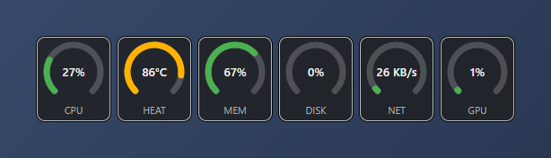
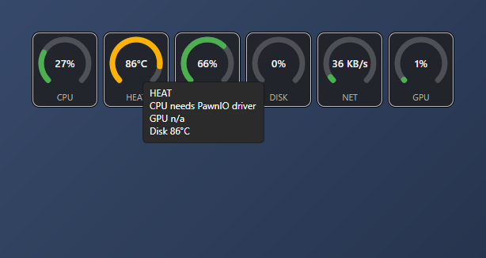
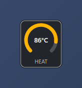
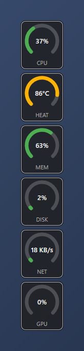

# DialBar

A small, always-on-top bar of circular gauges that shows your PC's health at a glance: **CPU, heat, memory, disk, network and GPU**. No window to open, no graphs to read: just six dials that turn green, amber or red.



## Features

- **Six live dials**: CPU load, hottest temperature, memory, disk activity, network throughput and GPU load. Refreshes every second.
- **Color-coded**: green below 70 %, amber from 70 %, red from 90 %.
- **Hover for details**: per-source temperatures, memory in GB, read/write speeds, adapter peak and more.

  

- **Click a dial to focus it**: one click leaves only that dial, the next click brings them all back.

  

- **Horizontal or vertical** layout, switchable from the tray menu.

  

- **Drag anywhere** to move it. The position is remembered, and ignored if that spot is no longer on a screen.
- **Tray icon**: show or hide the bar, toggle individual gauges, always-on-top, layout, start with Windows, About, Exit.
- **Private**: no network access, no telemetry. Everything stays on your machine.

## Requirements

- Windows 10 or 11 (x64)
- [.NET 8 SDK](https://dotnet.microsoft.com/download/dotnet/8.0) to build from source
- For **CPU temperature**: the [PawnIO](https://pawnio.eu) driver. Without it the Heat dial still works from the sensors that don't need it (typically disk and GPU), and the tooltip tells you what is missing.

## Install

Run `DialBar-Setup-<version>.exe` (asks for administrator rights once). It installs to `C:\Program Files\DialBar`:

- the **DialBar app**, with Start menu and (optional) desktop shortcuts
- the **sensor helper service** (`DialBar Sensor Helper`), started right away and on every boot

The app itself runs as a normal user, with no UAC prompt. Uninstall from **Settings > Apps**; this also removes the service.

To start DialBar when you sign in, tick **Start with Windows** in the tray menu.

### Building the setup

Needs [Inno Setup](https://jrsoftware.org/isinfo.php) 6.3+ (`winget install JRSoftware.InnoSetup`).

```powershell
.\scripts\package.ps1                 # dist\DialBar-Setup-0.1.0.exe
.\scripts\package.ps1 -Version 0.2.0
```

## Build and run from source

```powershell
git clone <this repository>
cd DialBar
.\scripts\build.ps1
src\DialBar.App\bin\Debug\net8.0-windows\DialBar.App.exe
```

Without the helper service, CPU and disk temperatures need administrator rights: run the exe from an elevated PowerShell, or install the service (see below).

> **Behind a corporate proxy or private NuGet feed?** If restore fails, make sure nuget.org is enabled (`dotnet nuget enable source nuget.org`). The repo's `nuget.config` uses nuget.org only.

## Using it

| Action | How |
| --- | --- |
| Move the bar | Drag it |
| Focus one gauge / show all | Click a dial / click again |
| Show or hide the bar | Left-click the tray icon |
| Hide a single gauge | Tray menu, untick the gauge |
| Vertical layout | Tray menu, **Vertical layout** |
| Always on top | Tray menu, **Always on top** |
| Start when you sign in | Tray menu, **Start with Windows** |
| Hide to tray or exit | Right-click the bar |

Settings are saved to `%APPDATA%\DialBar\settings.json`. Delete the file to reset everything.

## How temperatures work

| Source | Needs |
| --- | --- |
| GPU, disk (SMART / NVMe) | The helper service, or administrator rights |
| CPU | The helper service (or administrator rights) **and** the PawnIO driver |

The Heat dial shows the **hottest** of the sources it can read, and the tooltip lists each one.

### Sensor helper service

`src/DialBar.Helper` is a small Windows service that reads the sensors as SYSTEM and shares them with the app over a local-only named pipe (network access is denied). This is what lets the app run without elevation. The setup installs it; the app reads from it automatically. Don't start `DialBar.Helper.exe` yourself: the service already runs it.

For development, you can install just the service from your local build:

```powershell
# elevated PowerShell
.\scripts\install-helper.ps1             # install and start
.\scripts\install-helper.ps1 -Uninstall  # remove
```

## Project layout

```
src/
  DialBar.Core/                 gauge models, sampler, settings (no OS code)
  DialBar.Providers.Windows/    CPU, memory, disk, network, GPU, heat providers
  DialBar.Helper/               elevated sensor service
  DialBar.App/                  Avalonia UI: floating bar, dials, tray, About
installer/                      Inno Setup script
scripts/                        build, package and helper install scripts
docs/images/                    screenshots
REQUIREMENTS.md                 full requirements and roadmap
```

The metric code sits behind an `IMetricProvider` interface and the UI is [Avalonia](https://avaloniaui.net), so Linux and macOS providers can be added without touching the UI.

## Roadmap

- Settings window (refresh interval, thresholds, size, opacity, °C / °F)
- Global show/hide hotkey, click-through mode
- Signed installer
- Linux and macOS support

See [REQUIREMENTS.md](REQUIREMENTS.md) for the full list.

## Credits and licenses

- [Avalonia UI](https://avaloniaui.net) (MIT)
- [LibreHardwareMonitor](https://github.com/LibreHardwareMonitor/LibreHardwareMonitor) (MPL-2.0) for temperature sensors

## Author

© 2026 Ertan Asan ([@ertanasan](https://github.com/ertanasan))
